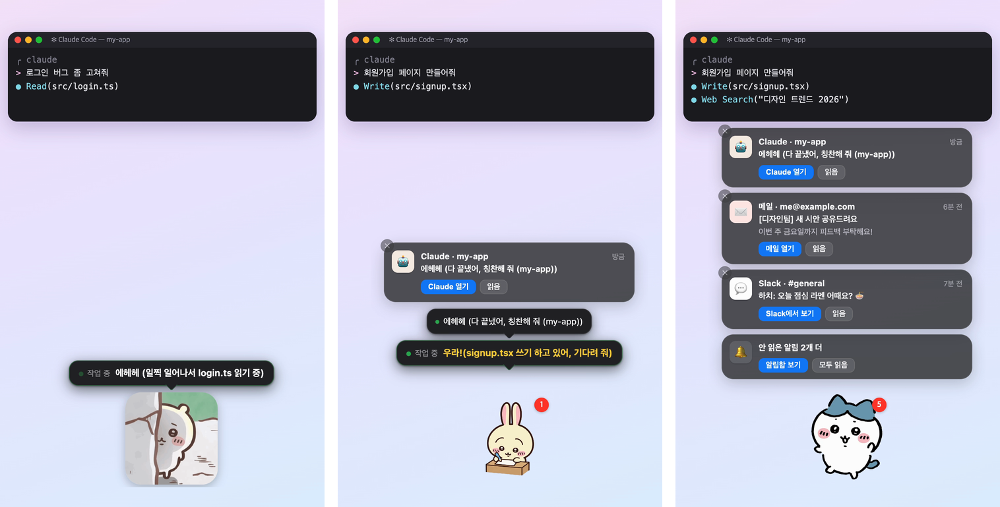
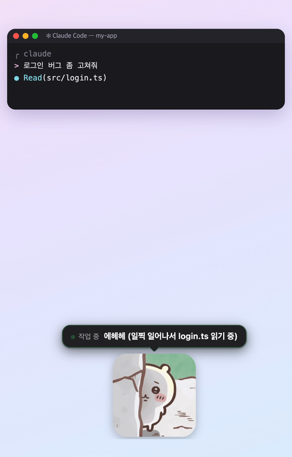
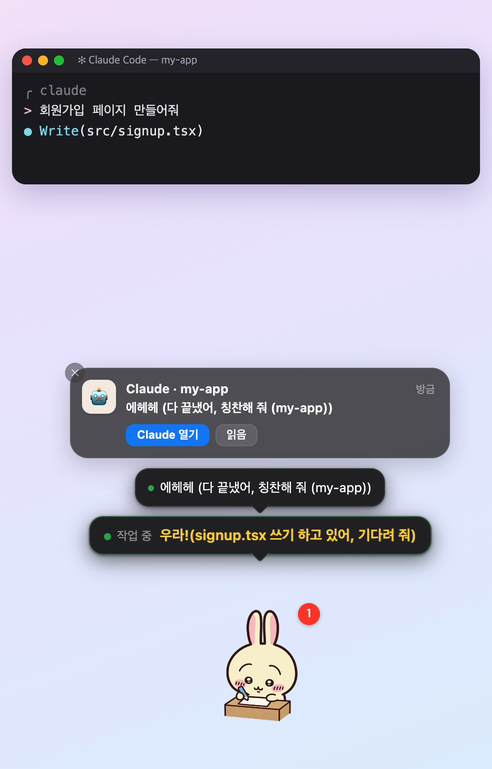
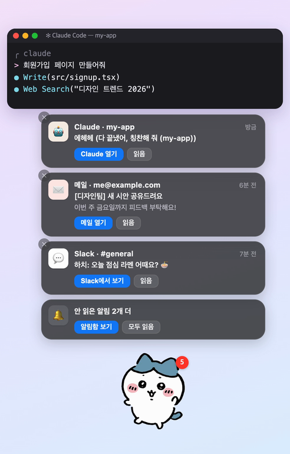
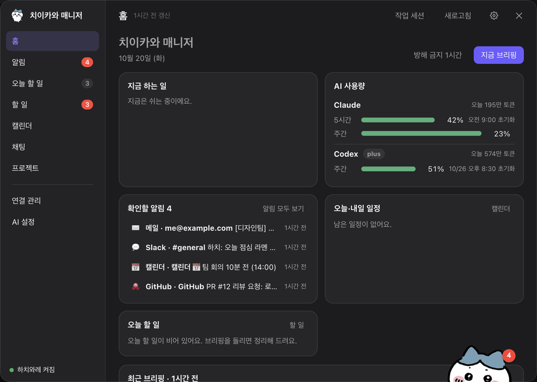
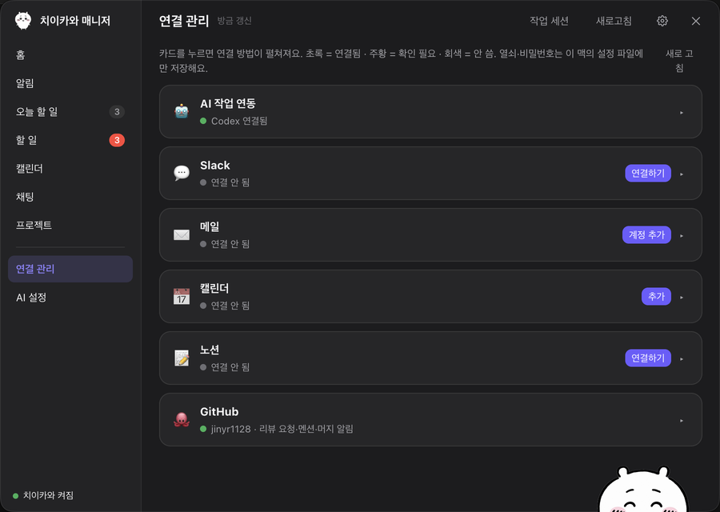

# 🐹 치이카와 매니저

바탕화면 구석에 치이카와 친구들이 살면서, **AI(Claude Code·Codex·Hermes)가 일하는 모습을 캐릭터 대사로 실시간 중계**하고 **메일·Slack·캘린더·노션·GitHub 알림**을 한곳에 모아 주는 맥 데스크톱 매니저예요.



> 비상업 팬 프로젝트예요. 무료이고 돈을 받지 않아요. 치이카와 캐릭터의 권리는 원작자(나가노)와 권리사에 있어요. 개인적으로 즐기는 용도로만 써 주세요. 권리자가 요청하면 바로 내릴게요.
> [시사 비서(shisa-agent)](https://github.com/cheo0y/shisa-agent)(MIT)를 바탕으로 만들었어요.

---

## 🤖 설치는 AI에게 맡기세요 (꼭 AI로!)

**애플 실리콘 맥(M1 이후)** 에서, **내 맥의 파일과 터미널을 다룰 수 있는 AI**(Claude Code·Codex 등)에게 이렇게만 말하면 돼요.

> **이 저장소 주소(`https://github.com/…`)를 붙이고 「이거 내 맥에 설치해줘. AGENTS.md 대로 해줘」**

- 웹 채팅창(ChatGPT 웹·Claude 웹)에 주소만 붙여 넣으면 설치할 수 없어요.
- 공개 저장소라 **GitHub 로그인이 필요 없어요.** AI가 [`AGENTS.md`](AGENTS.md)를 읽고 받기 → 설치 → 확인까지 해요.
- 사람이 직접 할 일은 두 가지예요. macOS가 「캘린더 접근」을 물으면 **[전체 접근 허용]**을 눌러요. 그리고 앱의 **「연결 관리」**에서 내 계정을 연결해요(열쇠·비밀번호는 AI에게 알려 주지 말고 직접 붙여 넣어요).

<details>
<summary>직접 설치(터미널)</summary>

```bash
git clone <이 저장소 주소>.git chiikawa-manager
cd chiikawa-manager
./ops/setup-mac.sh
```

- 이 저장소의 최신 릴리스에서 앱(zip)과, 있으면 캐릭터 묶음을 받아 SHA-256으로 검증해요.
- `/Applications/치이카와 매니저.app`에 넣고, 캐릭터는 `~/.cy-agent`에 넣어요.
- Claude Code가 있으면 Claude Code 연동을, Hermes가 있으면 Hermes 연동을 켜요. Codex는 설정이 필요 없어요.
- 옵션: `--build`(소스로 직접 만들기, Node.js 24+ 필요) · `--no-hooks`(AI 연동 안 켜기) · `--tag v0.4.8`(그 버전으로 설치)
- **업데이트**: 저장소 폴더에서 `git pull && ./ops/setup-mac.sh`. 설정과 캐릭터는 그대로 남아요.
- **지우기**: 앱을 끄고 `/Applications/치이카와 매니저.app`을 지워요. 데이터는 `~/.cy-agent`에 있고, Claude 연동은 `node ops/claude-hooks.mjs off`로 꺼요.

</details>

---

## 한눈에 보기

| AI가 일하는 동안 | 캐릭터마다 대표 색 말풍선 | 알림을 한곳에 |
|---|---|---|
|  |  |  |

| 두 번 클릭: 말 걸기·칩 | 홈: AI 사용량·알림·일정 |
|---|---|
|  |  |

## 할 수 있는 일

**🛠 AI 작업 실시간 표시**
- Claude Code(터미널·데스크톱 Code 탭·IDE), Codex(CLI·ChatGPT 앱), Hermes Agent가 일하면 캐릭터가 작업 움짤을 틀고, 「login.ts 읽는 중」처럼 지금 하는 일을 **캐릭터 말투로** 말해요.
- 일이 끝나거나, 내 확인이 필요하거나, 토큰 한도에 걸리면 바로 알려 줘요. 한도에 걸렸을 때는 언제 다시 쓸 수 있는지도 알려 줘요.
- 홈 화면의 **AI 사용량**에서 Claude·Codex 한도를 몇 % 썼는지(5시간·주간), 언제 초기화되는지, 오늘 쓴 토큰을 봐요. 터미널 Claude Code 아래 상태 줄에도 `🐹 5시간 42% · 주간 23%`처럼 나와요.

**📬 알림 모으기**
- 메일(여러 계정)·Slack(DM·멘션)·캘린더(회의 30분·10분 전)·노션(마감·댓글)·GitHub(리뷰 요청·멘션)을 캐릭터 위 카드로 보여 줘요. 읽기 전에는 사라지지 않아요.
- 카드에서 바로 **열기·읽음**을 누를 수 있어요. Slack 답장과 승인된 PR 머지도 카드에서 해요.

**💬 캐릭터와 놀기**
- 캐릭터를 **두 번 클릭**하면 말을 걸 수 있어요. AI를 연결했다면 입력창이 뜨고, 입력창 왼쪽 **＋** 에 「응원해 줘」「춤춰 줘」「다음 일정은요?」 같은 칩이 있어요. AI가 없으면 칩이 바로 떠요.
- 패널의 「채팅」에서는 길게 대화하고 파일도 붙일 수 있어요.

**📅 하루 챙기기**
- 홈, 오늘 할 일, 할 일, 프로젝트, 캘린더(주·월·일), 집중하기(집중 시간 기록) 탭이 있어요.
- 출근 인사, 점심 알림, 퇴근 10분 전 인사와 날씨 알림을 해요(근무 시간은 설정에서 바꿔요).
- 자리를 30분 넘게 비웠다 돌아오면, 그리고 퇴근 전에 **브리핑**으로 밀린 메일·Slack·AI 작업을 정리해 줘요.
- **방해 금지**(1시간 등)와 **회의 중 자동으로 조용히** 모드가 있어요. 머지 승인과 오류만 예외로 보여요.

## 쓰는 법

| 하는 것 | 하는 일 |
|---|---|
| 캐릭터 한 번 클릭 | 패널(홈·알림·할 일…) 열기 |
| 캐릭터 두 번 클릭 | 말 걸기, 「응원해 줘」·「춤춰 줘」 칩 |
| 캐릭터 끌기 | 아무 데나 옮기기 |
| 캐릭터 오른쪽 클릭 | 메뉴 |
| 메뉴 막대의 **캐릭터 얼굴 아이콘** | 홈 · 알림함 · 방해 금지 · **캐릭터 바꾸기** · 지금 브리핑 · Claude Code·Hermes 연동 · 설정 |

Dock에는 아이콘이 없어요. 메뉴 막대(화면 위 오른쪽)의 얼굴 아이콘을 찾아 주세요.

## 캐릭터

기본 캐릭터 8명이 들어 있어요. 말투와 **말풍선 대표 색**이 캐릭터마다 달라요.

| 캐릭터 | 말투 | 대표 색 |
|---|---|---|
| 치이카와 | 「싫어」「에에에」 같은 소리 뒤 괄호에 뜻 — `에헤헤 (오늘도 같이 해 보자!)` | 흰색 |
| 우사기 | 외침 뒤 괄호에 뜻 — `우라! (오늘 할 일 3개 남았어)` | 개나리 노랑 |
| 하치와레 | 밝은 반말 | 하늘색 |
| 시사 | 제주 사투리 존댓말 — `고맙수다!` | 주황색 |
| 쿠리만쥬 | 「캬」 뒤 괄호에 뜻 | 초록색 |
| 랏코 | 차분하고 듬직한 말투 | 회색 |
| 카니 | 소리 뒤 괄호에 뜻 — `헤헤헤... (같이 힘내 보자!)` | 분홍색 |
| 모몽가 | 떼쓰는 말투 — `칭찬하란 말이야아아!!!` | 연보라 |

- 일하는 동안 나오는 **작업 움짤은 캐릭터마다 3개 이상**이고 10초마다 바뀌어요.
- **캐릭터 만들기**: 메뉴 막대 → 설정… → 캐릭터 → 「＋ 새 캐릭터」에서 움짤(gif·png·webm)을 넣어 내 캐릭터를 만들어요. 움짤 배경 지우기·묶음 내보내기·들여오기 도구는 [`ops/character-pack`](ops/character-pack/README.md)에 있어요.
- 둘이 주고받는 캐릭터도 만들 수 있어요. 대사를 `모몽가: … / 카니: …`처럼 쓰면 한 줄에 한 사람씩, 각자 색으로 보여요.

## 연결 (앱의 「연결 관리」)



| 연결 | 하는 일 | 필요한 것 |
|---|---|---|
| AI 작업 연동 | Claude Code·Codex·Hermes 작업 표시 | Claude Code·Hermes는 버튼 한 번, Codex는 자동 |
| Slack | 내 DM·멘션 알림, 카드에서 답장 | 읽기용 Slack 앱의 User OAuth Token(`xoxp-`), 답장하려면 `chat:write` 권한 |
| 메일 | 새 메일 알림(여러 계정) | Gmail은 앱 비밀번호(2단계 인증 필요), 네이버·다음 등 IMAP |
| 캘린더 | 회의 30·10분 전 알림, 회의 중엔 조용히 | 맥 「캘린더」 앱에 넣은 계정(구글·네이버 CalDAV·iCloud) 또는 iCal 비공개 주소 |
| 노션 | 내 할 일 마감, 수정·새 댓글 알림 | 노션 내부 통합 시크릿(`ntn_`) + 알림받을 페이지에 통합 연결(회사 워크스페이스는 관리자 허용이 필요할 수 있어요) |
| GitHub | 리뷰 요청·멘션 알림, 승인된 PR 머지, 댓글 답장 | `gh` 로그인 |

캐릭터와 자유롭게 대화하거나 브리핑을 요약하려면 AI(Claude Code·Codex 또는 API 키)를 「AI 설정」에서 골라요. AI가 없어도 알림·할 일·칩·집중하기는 다 돼요.

## 개인정보와 안전

- 메일·메시지·할 일·대화·열쇠는 모두 **이 맥의 `~/.cy-agent/` 안에만** 있어요. 저장소나 릴리스에는 들어가지 않아요.
- 열쇠·비밀번호는 `config.json`에 저장되고, 나만 읽을 수 있는 권한(600)으로 만들어요. 로그에는 남기지 않아요.
- 로컬 서버는 `127.0.0.1`에서만 열리고, 전용 헤더가 없는 쓰기 요청은 거절해요.
- AI를 고르면 브리핑과 대화에 필요한 글이 그 AI 회사로 가요. 날씨 지역을 고르면 Open-Meteo에 위치만 보내요. 새 버전 확인으로 하루 한 번 GitHub에 버전 번호를 물어요(설정에서 끌 수 있어요).

## 더 보기

- [자세한 설명(개발자·고급 사용자용)](docs/자세한-설명.md): 할 일·프로젝트·집중하기·근무 시간·날씨·코드 작업·설정 파일·폴더 구조
- [연결 가이드](docs/connect/): Slack·메일·캘린더·노션 등 하나씩
- [릴리스·변경 기록](../../releases)

### 최근 변경

- **v0.4.8** 말투 검사·정리(시사 사투리·아노코 소리·괄호), 업데이트 안내와 `./ops/update.sh` 정리, 문서 그림 새로.
- **v0.4.7** 대사의 조사가 받침에 맞게 자동으로 골라져요(「명령 실행이야」). 공개 저장소에서는 로그인 없이 설치돼요.
- **v0.4.6** 모든 캐릭터 말풍선에 대표 색. 작업 움짤 3개 이상. 깨진 그림 교체.
- **v0.4.5** 주고받는 대사는 한 줄에 한 사람씩. 가로로 긴 장면은 크게, 움짤 여백 자르기.
- **v0.4.4** 2인 대화형 캐릭터. 작업 움짤 교체 버그 수정.
- **v0.4.1** 메뉴 막대 캐릭터 얼굴, 홈 AI 사용량.

## 라이선스

코드는 MIT 라이선스예요([LICENSE](LICENSE)). [시사 비서(shisa-agent)](https://github.com/cheo0y/shisa-agent)를 바탕으로 만들었어요. 치이카와 캐릭터 그림의 권리는 원작자와 권리사에 있어요.
